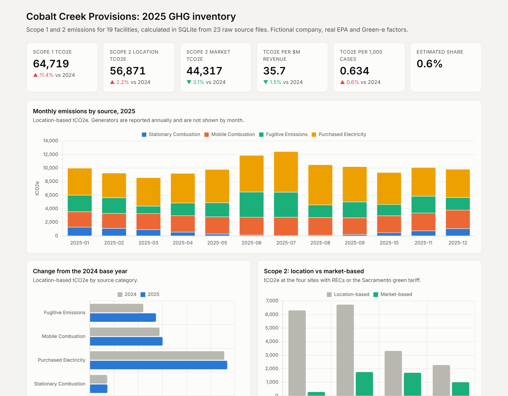
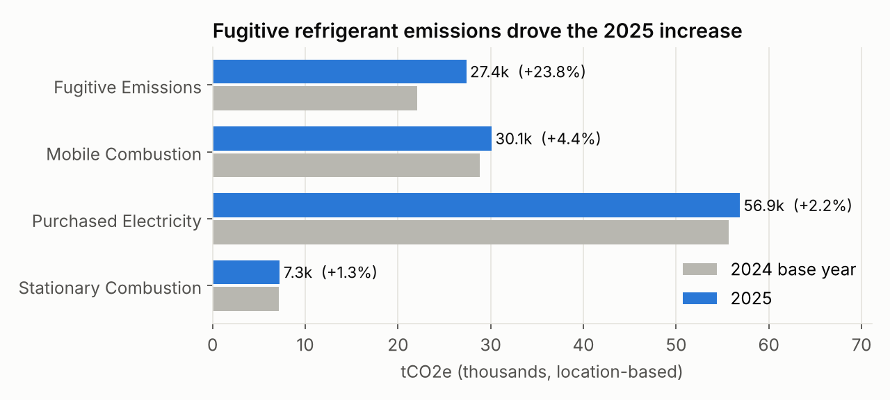
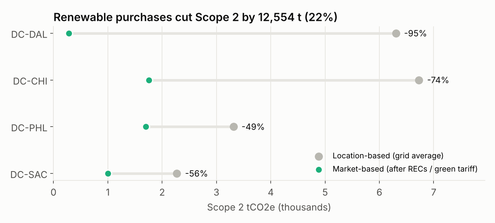
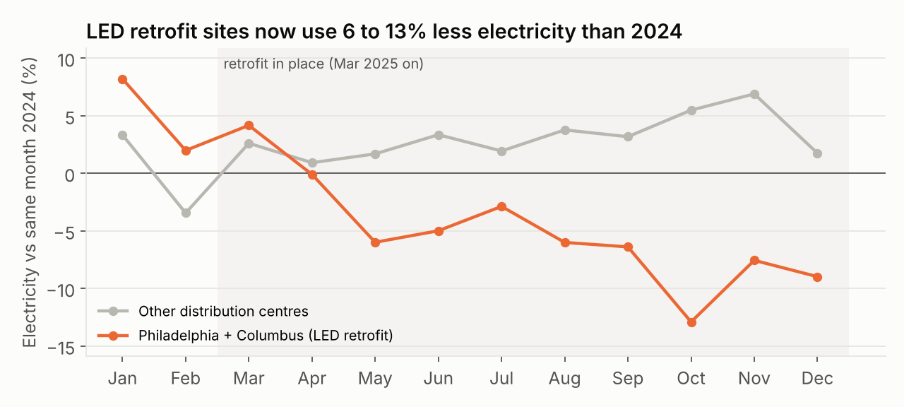
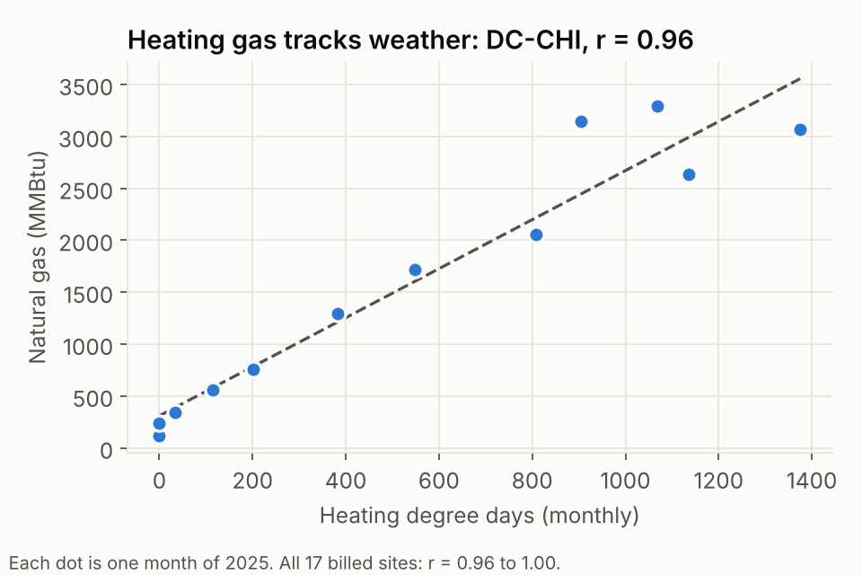
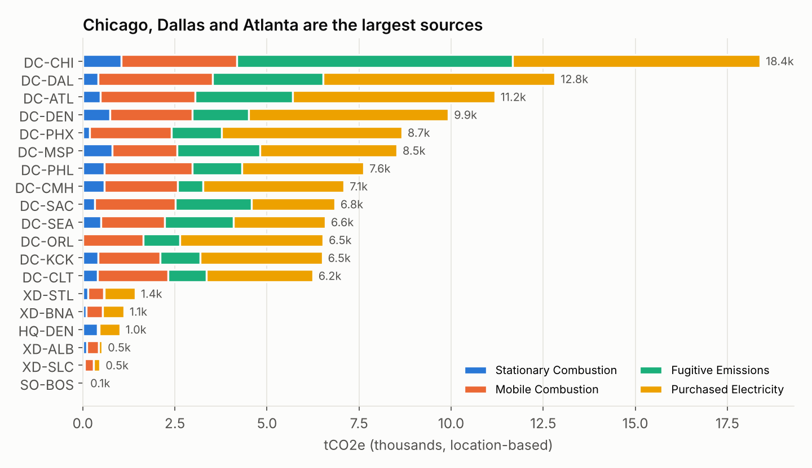
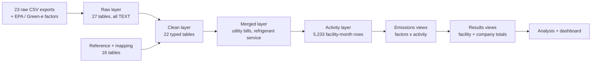

# Greenhouse Gas Inventory Analysis in SQL

**A 2025 Scope 1 and 2 carbon inventory for a 19-site food distributor, built end to end in SQLite from 23 messy source files, then analysed for cost and emissions reduction opportunities.**

Capstone for the Coursera *SQL for Data Science* specialisation, by Anthony Borrelli. The company, Cobalt Creek Provisions (CCP), is fictional; the emission factors are real (US EPA, Green-e, IPCC).

**[Dashboard preview below]** · [Analysis queries](sql/20_analysis.sql) · [Data model](docs/ERD.md) · [Methodology](docs/methodology_rules.md)

[](https://anthony-borrelli.github.io/GHG_Capstone_Project/dashboard/)

---

## Results at a glance

| 2025 result | Value | vs 2024 |
| --- | --- | --- |
| Scope 1 (direct: fuel, fleet, refrigerants) | **64,719 tCO2e** | +11.4% |
| Scope 2, location-based (grid average) | **56,871 tCO2e** | +2.2% |
| Scope 2, market-based (after renewable purchases) | **44,317 tCO2e** | -3.1% |
| Emissions intensity | **35.7 tCO2e per $M revenue** | -1.5% |
| Share of inventory estimated (not from client data) | **0.6%** | |
| Benchmark check | **18 of 19 facilities within 1%** of an independent expected result | |

## Key findings and recommendations

**1. One refrigerant leak explains most of the year's increase.**
Fugitive refrigerant emissions rose 24% (+5,264 t). Chicago alone added 4,493 t (85% of that increase), led by a 1,817 lb R-404A loss in July. Chicago leaked 44% of its installed refrigerant charge in 2025, against 14 to 31% at the other distribution centres.
*Recommendation:* continuous leak detection on Chicago's racks, then a phased switch of R-404A systems (GWP 3,943) to R-448A (GWP 1,273), which cuts the impact of every future leak by about two thirds.



**2. Renewable purchases cut Scope 2 by 22%, but only at four sites.**
Renewable energy certificates (RECs) and Sacramento's green tariff removed 12,554 t from market-based Scope 2. Dallas is 95% covered. A 5,000 MWh REC batch for Columbus was excluded because it was the wrong vintage (2023), a common reporting error this pipeline catches automatically.
*Recommendation:* buy current-year RECs for Kansas City, Denver and Minneapolis, the sites where the market-based number is higher than the grid average.



**3. The LED lighting retrofit is working and should be rolled out.**
Philadelphia and Columbus use 6 to 13% less electricity than the same month in 2024, while the other distribution centres use 2 to 7% more. The gap opened from April, a month after the retrofit.
*Recommendation:* extend the retrofit to the remaining 11 distribution centres, starting with the highest electricity users (Dallas, Chicago, Phoenix).



**4. Weather and volume explain most of the rest, so targets should be normalised.**
Heating gas tracks heating degree days almost perfectly at every site (Pearson r = 0.96 to 1.00), and on-road diesel tracks cases shipped (r = 0.79 to 0.97). 2025 was 3.3% colder than 2024. Emissions per 1,000 cases shipped stayed flat (0.630 to 0.634 t), so most of the fleet and gas growth is business growth, not inefficiency.
*Recommendation:* report gas per degree day and fleet emissions per 1,000 cases alongside absolute totals.



**5. Where the emissions are.** Chicago, Dallas and Atlanta account for 35% of the total. Refrigerant leaks are the largest single lever at Chicago; electricity is the largest everywhere else.



---

## The business problem

CCP's sustainability team needed its first in-house 2025 carbon inventory under the GHG Protocol: facility and company totals, Scope 2 reported both location- and market-based, a comparison against the 2024 base year, and recommendations for leadership. The data arrived as exports from eight different systems (a bill-payment service, an energy platform, a fuel card provider, two refrigeration contractors, telematics, finance and operations), none of them reviewed for quality.

## How it was built



| Stage | What happened | Scripts |
| --- | --- | --- |
| Load | Every file imported exactly as received (as TEXT, so leading zeros and odd formats survive), with one-click rebuild | `load/`, `sql/01a`, `01b` |
| Explore | Profiled every table: grain, keys, duplicates, units, date formats ([data inventory](docs/data_inventory.md)) | `sql/00` |
| Clean | Fixed 20+ issues: 250 duplicate fuel transactions, 9 duplicate bills, 416 water/sewer rows, mixed date formats, 11 units of measure, a dozen spellings of refrigerant names, a meter missing from the account map | `sql/03` to `14` |
| Model | 44-table schema with primary and foreign keys enforced on every rebuild ([ERD](docs/ERD.md)) | `sql/02` |
| Merge | Combined 4 utility vendors and 2 refrigeration contractors into one table each, converting kg, MWh, therms, Mcf and CCF to standard units | `sql/15` |
| Calculate | Prorated 491 utility bills to calendar days, rebuilt fuel use from tank readings and cylinder counts, filled a 57-day billing gap, estimated an unbilled office from floor area | `sql/16`, `17` |
| Emissions | Applied EPA factors by fuel, vehicle class and model year; refrigerant GWPs; grid and residual-mix rates; renewable certificates | `sql/18`, `19` |
| Analyse | Year-over-year, intensity, correlations, leak rates, retrofit impact, base-year significance test | `sql/20` |

## Skills demonstrated

| Analyst skill | Where it shows up |
| --- | --- |
| Data cleaning and validation | Duplicates, unit and date standardisation, reconciled row counts at every stage ([loading doc](docs/loading_raw_data.md)) |
| Data modelling | Layered raw / clean / merged / activity design, 37 enforced foreign keys ([ERD](docs/ERD.md)) |
| Advanced SQL | CTEs, window functions, recursive CTE calendar, conditional aggregation, CROSS JOIN unpivot, date arithmetic, views |
| Multi-source reconciliation | Matching facilities across IDs, site numbers, account numbers and addresses |
| Business analysis | KPIs, intensity metrics, correlation, before/after impact, recommendations with numbers |
| Quality assurance | Every step checked for row counts, totals, duplicates and NULLs; results validated against an independent benchmark |
| Documentation and reproducibility | Methodology rules, data inventory, one-click rebuild from raw files |

## Repository map

```
data/           raw 2025 exports, 2024 base year, reference factor files
sql/            numbered scripts: 00 explore, 01-02 schema, 03-14 clean, 15 merge,
                16-17 activity, 18-19 emissions and results views, 20 analysis
load/           load_raw_data.sql, clean_data.sql, rebuild_database.bat
dashboard/      interactive dashboard (index.html), chart images, build script
docs/           methodology, data inventory, ERD, loading guide, change log
```

## Run it yourself

1. Install the [SQLite command-line tool](https://www.sqlite.org/download.html) and set its path in `load/rebuild_database.bat`.
2. Double-click `load/rebuild_database.bat`. It builds `db/ghg_capstone_project.db` from the raw files and prints row counts to check against [docs/loading_raw_data.md](docs/loading_raw_data.md).
3. Run any query in `sql/20_analysis.sql`, or rebuild the charts with `python dashboard/build_dashboard.py` (needs matplotlib).

## Methodology

GHG Protocol Corporate Standard, operational control boundary. EPA GHG Emission Factors Hub 2025 (eGRID2023), Green-e 2025 Residual Mix, IPCC AR5 100-year GWPs, EIA CBECS 2018 for the unbilled office. Boundary changes (a mid-year acquisition and a lease exit) were handled by date, and the acquisition passed the 5% base-year significance test (0.6%), so 2024 was not restated. Full rules: [docs/methodology_rules.md](docs/methodology_rules.md).
