# Entity Relationship Diagram (final, as built)

The proposed ERD from Milestone 1 is kept unchanged in [`ERD.txt`](ERD.txt) to show how the design evolved.

- **Full column-level ERD:** [`ERD_final.txt`](ERD_final.txt). Paste it into [dbdiagram.io](https://dbdiagram.io) to render.
- **Key-only diagram below:** primary and foreign keys for all 44 typed tables (the 27 `raw_` landing tables are left out; each feeds exactly one clean table). GitHub renders it; use the zoom controls.

## Layers

| Layer | Tables | Purpose |
| --- | --- | --- |
| Raw | 27 `raw_` tables | Every source file loaded exactly as received, all TEXT |
| Reference | 10 `ref_` tables | Emission factors, GWPs, unit conversions, ZIP to eGRID, CBECS intensity |
| Mapping | 6 `map_` tables | Translate source codes (fuel products, utility accounts, activity types, vehicle classes, weather stations, calendar days) |
| Clean source | 22 tables | One typed, de-duplicated table per source system |
| Base year | 2 tables | The 2024 inventory as provided |
| Merged | `utility_bill`, `refrigerant_service` | One table per emission source with vendors combined |
| Activity | `fleet_activity`, `inventory_activity_data` | Every source in one shape: facility, month, activity type, quantity |
| Views | `emissions`, `scope2_market`, `facility_totals`, `company_summary` | Emissions calculations and results (no stored data) |

## Keys and relationships

```mermaid
erDiagram
    arcticair_log {
        text work_order PK
        text equipment_id FK
    }
    base_year_activity {
        integer activity_id PK
        text facility_id FK
    }
    base_year_inventory {
        text facility_id PK
        text activity_type PK
    }
    chi_midwest_invoice {
        text facility_id PK
        text month PK
    }
    energyhub_consumption {
        text account_number FK
        text meter_number PK
        text start_date PK
    }
    facility {
        text facility_id PK
        text zip FK
        text weather_station_id FK
    }
    financial {
        integer fiscal_year PK
    }
    fleet_activity {
        integer fleet_activity_id PK
        text facility_id FK
        text unit_number FK
        text activity_type FK
    }
    fuel_card_assignment {
        text card_number PK
        text unit_number FK
        text assigned_from PK
    }
    fuel_card_transaction {
        text transaction_id PK
        text unit_number FK
    }
    generator_log {
        text facility_id PK
        text entry_date PK
        text entry_type PK
    }
    inventory_activity_data {
        integer activity_id PK
        text facility_id FK
        text activity_type FK
        text refrigerant FK
    }
    map_activity_type {
        text activity_type PK
    }
    map_calendar_day {
        text calendar_date PK
    }
    map_fuel_product {
        text product_description PK
    }
    map_utility {
        text account_number PK
        text facility_id FK
    }
    map_vehicle_class {
        text vehicle_class PK
    }
    map_weather_station {
        text weather_station_id PK
    }
    mesa_gas_bill {
        text account_number PK
        text curr_read_date PK
    }
    mileage_claim {
        text unit_number PK
        text month PK
    }
    operation_kpi {
        text facility_id PK
        text month PK
    }
    polar_log {
        text work_order PK
        text equipment_id FK
        text facility_id FK
    }
    propane_delivery {
        text facility_id PK
        text delivery_date PK
    }
    rec_retirement {
        text batch_id PK
        text facility_id FK
    }
    ref_building_intensity {
        text building_type PK
    }
    ref_egrid_rate {
        text egrid_subregion PK
        integer data_year PK
    }
    ref_gwp {
        text gas PK
    }
    ref_mobile_ch4_n2o_nonroad {
        text equipment_type PK
        text fuel_type PK
    }
    ref_mobile_ch4_n2o_onroad {
        text vehicle_class PK
        text fuel_type PK
        integer model_year_start PK
    }
    ref_mobile_co2 {
        text fuel_type PK
    }
    ref_residual_mix {
        text egrid_subregion PK
        integer data_year PK
    }
    ref_stationary_factor {
        text fuel_type PK
    }
    ref_unit_conversion {
        text from_unit PK
        text to_unit PK
    }
    ref_zip_egrid {
        text zip PK
    }
    refrigerant_service {
        text work_order PK
        text equipment_id FK
        text facility_id FK
        text source_system PK
    }
    refrigeration_equipment {
        text equipment_id PK
        text facility_id FK
        text refrigerant FK
    }
    slc_utility_bill {
        text account_number PK
        text start_date PK
    }
    supplier_emission_rate {
        text utility_name PK
        text product PK
        integer data_year PK
    }
    telematics_mileage {
        text unit_number PK
        text month PK
    }
    utility_bill {
        integer utility_bill_id PK
        text facility_id FK
        text account_number FK
    }
    utilitypay_bill {
        text invoice_number PK
        text account_number FK
    }
    valley_consumption {
        text account_number FK
        text meter_number PK
        text month PK
    }
    vehicle {
        text unit_number PK
        text facility_id FK
    }
    weather_degree_days {
        text weather_station_id PK
        text month PK
    }
    refrigeration_equipment ||--o{ arcticair_log : "equipment_id"
    facility ||--o{ base_year_activity : "facility_id"
    facility ||--o{ base_year_inventory : "facility_id"
    facility ||--o{ chi_midwest_invoice : "facility_id"
    map_utility ||--o{ energyhub_consumption : "account_number"
    map_weather_station ||--o{ facility : "weather_station_id"
    ref_zip_egrid ||--o{ facility : "zip"
    map_activity_type ||--o{ fleet_activity : "activity_type"
    vehicle ||--o{ fleet_activity : "unit_number"
    facility ||--o{ fleet_activity : "facility_id"
    vehicle ||--o{ fuel_card_assignment : "unit_number"
    vehicle ||--o{ fuel_card_transaction : "unit_number"
    facility ||--o{ generator_log : "facility_id"
    ref_gwp ||--o{ inventory_activity_data : "refrigerant"
    map_activity_type ||--o{ inventory_activity_data : "activity_type"
    facility ||--o{ inventory_activity_data : "facility_id"
    facility ||--o{ map_utility : "facility_id"
    map_utility ||--o{ mesa_gas_bill : "account_number"
    vehicle ||--o{ mileage_claim : "unit_number"
    facility ||--o{ operation_kpi : "facility_id"
    facility ||--o{ polar_log : "facility_id"
    refrigeration_equipment ||--o{ polar_log : "equipment_id"
    facility ||--o{ propane_delivery : "facility_id"
    facility ||--o{ rec_retirement : "facility_id"
    facility ||--o{ refrigerant_service : "facility_id"
    refrigeration_equipment ||--o{ refrigerant_service : "equipment_id"
    ref_gwp ||--o{ refrigeration_equipment : "refrigerant"
    facility ||--o{ refrigeration_equipment : "facility_id"
    map_utility ||--o{ slc_utility_bill : "account_number"
    vehicle ||--o{ telematics_mileage : "unit_number"
    map_utility ||--o{ utility_bill : "account_number"
    facility ||--o{ utility_bill : "facility_id"
    map_utility ||--o{ utilitypay_bill : "account_number"
    map_utility ||--o{ valley_consumption : "meter_number"
    map_utility ||--o{ valley_consumption : "account_number"
    facility ||--o{ vehicle : "facility_id"
    map_weather_station ||--o{ weather_degree_days : "weather_station_id"
```

